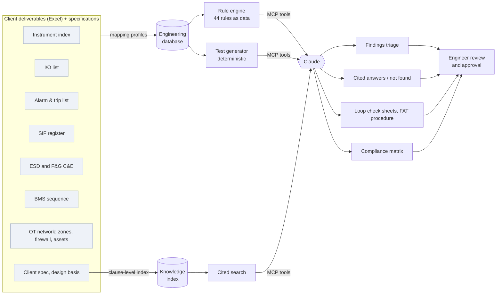
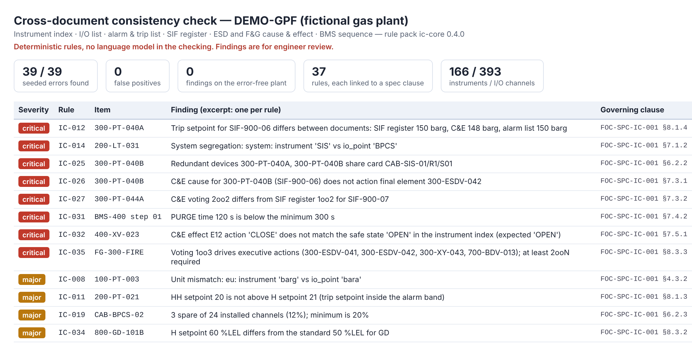
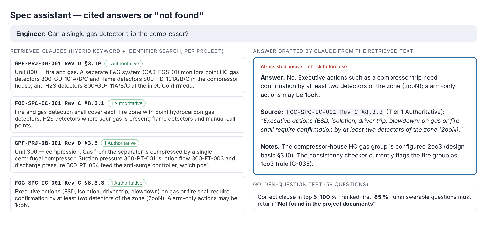
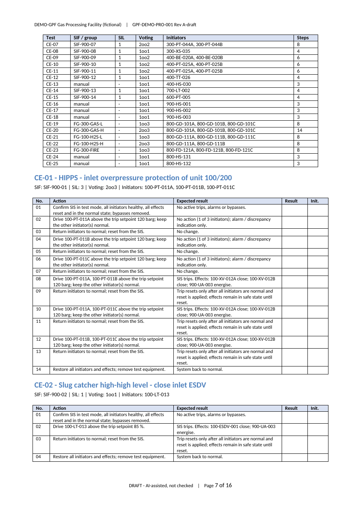
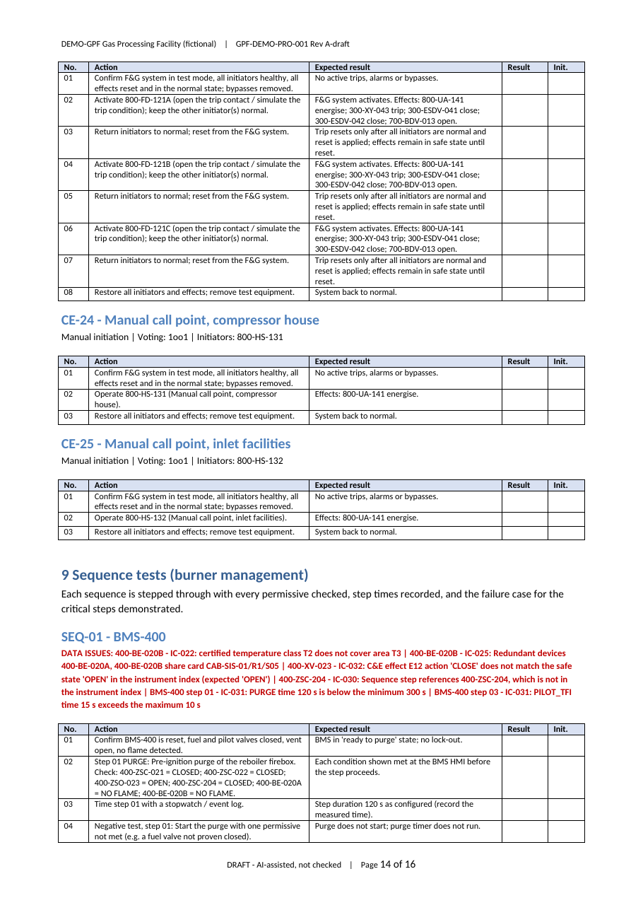
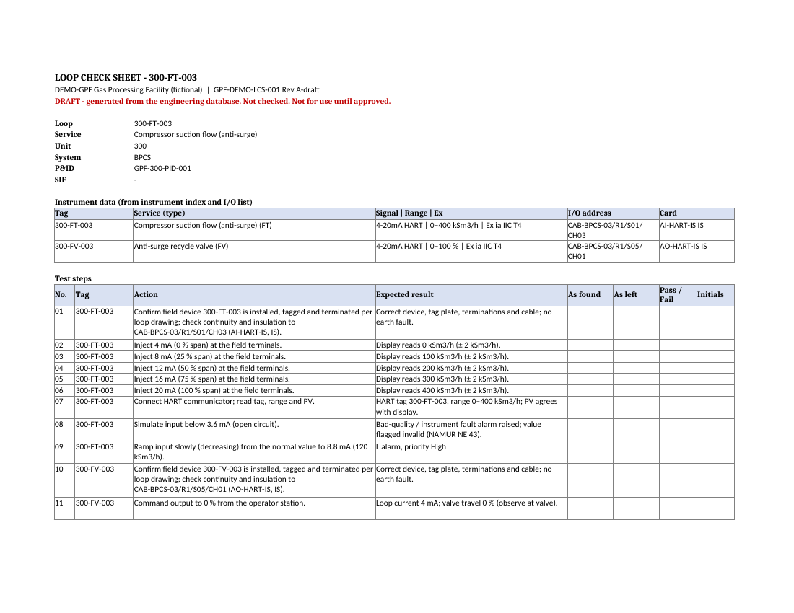
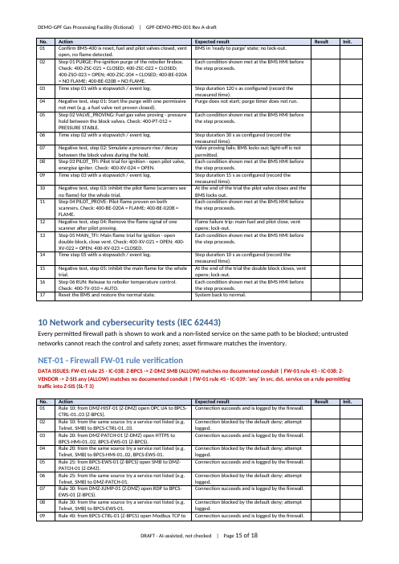

# I&C Engineering Copilot

**An AI-assisted engineering system for Instrumentation & Control projects: it checks deliverables against
each other, answers specification questions with clause citations, and generates test documents from the
engineering data — with the engineer in control.**

> Personal project by **Kidane Berhane**, I&C engineer, developed on personal time with personal resources.
> Everything shown here runs on **DEMO-GPF**, a *fictional* gas processing facility designed for testing.
> No company, client or project data is used. The engine source is kept private; this repository shows the
> design, the results and real outputs. A walkthrough or code review is available on request.

---

## Why

On an I&C project the same information lives in many deliverables — instrument index, I/O list, alarm and
trip list, SIF register, cause & effect matrices, sequence lists — and they drift apart. Engineers spend
days cross-checking them by hand, and test documents (loop checks, FAT procedures) are retyped from the
same data. Errors that slip through surface late, at FAT or site, where they are expensive.

## How it works

Four principles, taken from functional-safety practice:

1. **Engineering data is the source of truth.** Client Excel deliverables are imported into one structured
   data model through configurable mapping profiles. Documents are generated *from* the data.
2. **Deterministic code does the checking and the arithmetic.** 44 consistency rules are written as data
   (YAML), each linked to the governing specification clause. No language model grades its own work.
3. **Claude is the reasoning and drafting layer.** Through MCP tool servers it triages findings, answers
   questions with citations — or says *"not found"* — and drafts narrative text.
4. **Engineers stay in control.** Every output is marked as an unchecked draft with a generation record
   (data snapshot, source revisions, rule-pack and template versions). The copilot never signs.

**Stack:** Python · SQLite (PostgreSQL-ready schema) · YAML rule packs, mapping profiles and document
templates · three MCP servers (`tagdb`, `docsearch`, `docgen`) · Claude via Claude Code / desktop · Skills
for engineering procedures · openpyxl / python-docx rendering · unittest test suite.

## What it does

### 1. Cross-document consistency checker

Duplicate tags and I/O addresses, range and unit mismatches (incl. barg/bara), alarm hierarchy and
setpoints within range, trip setpoints identical across SIF register, C&E and alarm list, SIS/BPCS/FGS
segregation, IS devices on IS channels, Ex certification vs area classification, redundant devices on
separate cards, SIF voting vs SIL, C&E completeness and safe positions, BMS purge and trial-for-ignition
times, F&G detector setpoints and 2ooN confirmation, spare capacity, fiscal meter run completeness.

**OT network (IEC 62443):** every permitting firewall rule maps to a documented conduit, no 'any' rules
into zones of SL-T 2 and above, untrusted zones reach control and safety zones only through the DMZ,
zone security levels meet the client minimum, asset inventory complete, firmware checked against
vendor advisories.

### 2. Specification assistant

Clause-level index of the client specification and design basis (revision-aware, superseded revisions
excluded, one index per project). Hybrid keyword + identifier search finds tags, clause numbers and
voting expressions verbatim; answers cite the clause or say *"not found in the project documents"*.
A requirements register and compliance matrix are built from the spec and linked to the checker results.

### 3. Test document generator

Loop check sheets and a FAT procedure generated from the database: 5-point calibration checks in mA,
alarm setpoints converted to mA, Pt100 resistances per IEC 60751, NAMUR line-fault checks, C&E functional
tests with the full **MooN voting matrix** (M−1 initiators must not trip, M must trip), F&G voting groups,
BMS sequence tests with negative cases, and IEC 62443 network tests (a positive and a default-deny
negative test per firewall rule, zone isolation scans from untrusted zones, firmware verification). Open data issues are printed on the affected loop or test.

| C&E tests with voting matrix | BMS sequence test |
|---|---|
|  |  |

## Results on the demo plant

| Measure | Result |
|---|---|
| Plant scope | Units 100–900: inlet & HIPPS, separation, compression (API 670 MPS, anti-surge), TEG dehydration with burner management, fiscal metering, condensate & produced water, flare & blowdown, fire & gas, ESD, and the OT network (zones, conduits, firewalls, asset inventory) |
| Data volume | 166 instruments · 393 I/O channels · 112 alarms/trips · 14 SIFs · 2 C&E matrices · BMS sequence · 8 network zones with firewall rule base |
| Seeded-error detection | **47 / 47** findings found, **0 false positives**; error-free version of the plant: **0 findings** |
| Rules | 44, each linked to a clause of the (fictional) client specification |
| Retrieval accuracy | 64 golden questions: correct clause in top 5 **98 %**, ranked first **84 %** |
| Retrieval, unseen wording | 24 held-out questions in an engineer's own words, never tuned on: top 5 **79 %**, first **46 %** — the honest measure of the vocabulary gap |
| Generated tests | 127 loop check sheets / 1,038 steps · 25 C&E functional tests · 1 BMS sequence test · network tests per firewall |
| Test suite | 58 automated tests, including "error-free plant gives zero findings" and a guard that fails if a project's tag format reappears in engine code |

Along the way the rules also caught **real mistakes in my own baseline design** — e.g. two SIL 3 HIPPS
valves on the same SIS output card. The design was fixed and the specification clause widened, rather
than the rule weakened.

## Sample outputs (fictional data)

- [FAT procedure (PDF, draft)](samples/FAT_Procedure_DRAFT.pdf)
- [Loop check sheets — excerpt (PDF, draft)](samples/Loop_Check_Sheets_excerpt_DRAFT.pdf)
- [Consistency check report](samples/Consistency_Check_Report.md)

## Proven on a second plant

A new project should be configuration, not code. To test that honestly, I built a second fictional
plant — **HELIOS-5**, a 20 MW green-hydrogen electrolysis plant for a different client — with a
different tag grammar (`12PT1101A` instead of `100-PT-011A`), combined cells (`0 – 40 bar(g)`,
`Ex ia IIC T4 Ga`), coded fail actions, a wide alarm schedule, "IPF" instead of "SIF", and different
requirement values (15 % spare, IEC-baseline voting, hydrogen detector levels).

I ran the **unchanged** engine first and recorded every failure before fixing anything: ten
failures, six of them **silent** — the checker quietly checked less (a redundant-transmitter error
was missed, loops were not grouped). Each was fixed generically in the engine, never for HELIOS-5
alone, and a rule that lacks a setting is now reported *NOT EVALUATED* instead of passing.

| | DEMO-GPF (gas) | HELIOS-5 (hydrogen) |
|---|---|---|
| Seeded errors found | 47 / 47 | 18 / 18 |
| False positives | 0 | 0 |
| Error-free plant | 0 findings | 0 findings |
| Project-specific engine code | — | **none** |

## Safety and governance

- No AI signatures; drafts stay visibly *unchecked* until a named engineer approves them.
- Every number that matters comes from deterministic code, never from model text.
- Rule checks run independently of the language model.
- Full generation record on every output; documents are fixed at the source and regenerated.
- Read-only access to engineering data; nothing is ever written to a control system.
- Document text is treated as data, never as instructions.

## Roadmap

- Pretrained embedding model in the semantic-ranker slot (a corpus-trained LSA ranker was built and measured: no gain on 73 clauses, so not adopted); public vendor datasheets in the index
- Answer-level evaluation of Claude on the golden questions

---

© 2026 Kidane Berhane. All rights reserved. Shared for portfolio purposes; no licence is granted to reuse
the content. All plant data, specifications and documents are fictional.
